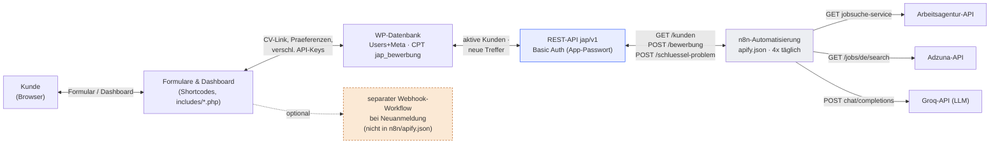
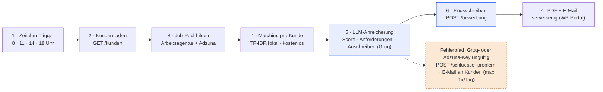

# Softwarearchitektur

Version 5.0.5 · Autor: Mohammed Othman

## Überblick

Das System besteht aus zwei unabhängig lauffähigen Teilen, die ausschließlich über die REST-API des Plugins miteinander sprechen:

- **WordPress-Plugin** (`job-automation-portal.php` + `includes/`): Kundenportal und Datenhaltung. Registrierung, CV-Upload, Praeferenzen, Dashboard, PDF-Erzeugung.
- **n8n-Workflow** (`n8n/apify.json`): eigenständige Automatisierung, die sich die Arbeit selbst holt (Pull) statt sie zugeschickt zu bekommen (Push).

Diese Trennung bedeutet: Das Portal funktioniert auch, wenn n8n gerade nicht läuft, und der Workflow lässt sich unabhängig vom Plugin-Code testen und ändern.

## Systemarchitektur

n8n zieht sich die Arbeit selbst (Pull), statt dass das Portal sie schiebt (Push). Die Registrierung kann zusätzlich einen separaten Webhook auslösen (Plugin-Einstellung `jap_n8n_webhook_url`), der aber nicht Teil des hier dokumentierten Workflows ist. Der eigentliche Suchlauf holt sich alle aktiven Kunden selbst, unabhängig davon, ob dieser Webhook konfiguriert ist.

| Komponente | Aufgabe | Dateien / Endpunkte |
|---|---|---|
| Formulare & Shortcodes | Registrierung, Login, Kundeneinstellungen, Dashboard, Kontakt, Rechtstexte | `includes/startseite.php`, `einstellungen.php`, `kontakt.php`, `rechtstexte.php`, `seiten.php` |
| WP-Datenbank | Nutzerkonten inkl. Praeferenzen als User-Meta; ein Custom-Post-Type `jap_bewerbung` pro Job-Treffer | `job-automation-portal.php` (register_post_type, register_post_meta) |
| REST-API `jap/v1` | Einzige Schnittstelle für n8n: Kunden abrufen, Treffer schreiben, ungültige Keys melden | `/kunden` · `/bewerbung` · `/schluessel-problem` |
| Verschlüsselung | Kunden-API-Keys nie im Klartext; Schlüssel aus WordPress-Salts abgeleitet | `includes/verschluesselung.php` |
| PDF-Erzeugung | Lebenslauf & Anschreiben serverseitig, ohne Google-Konto oder externen Dienst | `includes/pdf.php`, `pdf-document.php`, `lib/fpdf` |
| n8n-Automatisierung | Zeitgesteuerte Suche, Bewertung, Dokumentenerstellung | `n8n/apify.json` |
| Externe Dienste | Jobquellen und LLM-Bewertung, jeweils mit dem persönlichen Key des Kunden | Arbeitsagentur-Jobbörse-API · Adzuna · Groq |

## Automatisierungs-Pipeline

Kostenkontrolle sitzt vor der KI: Schritt 4 filtert und sortiert rein per Textstatistik (TF-IDF/Cosine-Similarity) und schickt nur die sechs besten Treffer pro Kunde in Schritt 5 an Groq. Das hält die LLM-Aufrufe klein und nutzt trotzdem den persönlichen Groq-Key jedes Kunden statt eines gemeinsamen Kontos.

**Warum ein gemeinsamer Job-Pool?** Adzuna erlaubt begrenzte Anfragen pro Monat. Der Workflow sucht deshalb einmal für alle Kunden zusammen (Städte + Suchbegriffe kombiniert) und teilt die Treffer danach pro Kunde auf, statt pro Kunde einzeln zu suchen.

**Warum harte Anforderungen rausfiltern?** Stellen mit Formulierungen wie "mehrjährige Berufserfahrung" oder "Senior" werden vor der Bewertung ausgeschlossen - das spart Groq-Aufrufe für Treffer, die für Studierende ohnehin nicht infrage kommen.

## Datenmodell

### Kunde — User-Meta

| Feld | Bedeutung |
|---|---|
| `jap_cv_url` | Link zum hochgeladenen Lebenslauf |
| `jap_standort` / `_key` | gewählte Stadt(e) für die Suche |
| `jap_suchweite` | Umkreis in km |
| `jap_arbeitszeit` / `_labels` | Werkstudent, Praktikum, Teilzeit, Minijob, Vollzeit, Abschlussarbeit |
| `jap_bereiche` / `jap_keywords` / `jap_branche` | gewählte Studienbereiche und die daraus abgeleiteten Suchbegriffe |
| `jap_status` | `aktiv`/`inaktiv` - steuert, ob n8n den Kunden im nächsten Lauf berücksichtigt |
| `jap_key_problem*` | Vermerk + Zeitpunkt, wenn ein Kunden-Key von Groq oder Adzuna abgelehnt wurde |

### Job-Treffer — Custom-Post-Type `jap_bewerbung`

| Feld | Bedeutung |
|---|---|
| `jap_user_id` | welchem Kunden der Treffer gehört |
| `jap_company` / `jap_location` / `jap_work_model` | Firma, Ort, Arbeitsmodell |
| `jap_score` / `jap_reason` | Groq-Bewertung (0-100) und Begründung |
| `jap_cv_link` / `jap_cover_link` | generierte PDF-Dokumente für diesen Treffer |
| `jap_job_url` / `jap_date_found` | Quelle der Stellenanzeige und Fundzeitpunkt |
| `jap_bewerbungs_email` / `jap_betreff` / `jap_brieftext` | erkannte Bewerbungsadresse und generierter Anschreiben-Text |

Ein Treffer wird über `jap_user_id` + `jap_job_url` auf Duplikate geprüft, bevor er gespeichert wird - der Workflow durchsucht ein mehrtägiges Zeitfenster und würde dieselbe Stelle sonst bei jedem Lauf erneut anlegen.

## Sicherheit

- Kunden-API-Keys (Groq, Adzuna) werden verschlüsselt gespeichert; der Schlüssel dafür stammt aus den WordPress-eigenen Salts (`AUTH_KEY` u. a.) und liegt damit nicht in der Datenbank selbst.
- Die REST-Endpunkte `jap/v1/*` sind nicht öffentlich - n8n meldet sich mit einem WordPress-Application-Passwort (Basic Auth) eines Kontos mit Schreibrechten an.
- Jeder Kunde nutzt seinen eigenen Groq- und Adzuna-Key. n8n selbst hält kein gemeinsames LLM-Guthaben - ein missbrauchter Key trifft nur den einen Kunden, nicht den ganzen Betrieb.
- Ein ungültiger Key führt zu einer expliziten Fehlermeldung an den Kunden (höchstens einmal pro Tag), statt stillschweigend keine Treffer mehr zu liefern.
- Datenschutz- und Impressum-Texte sind laut Code-Kommentar Vorlage, keine Rechtsberatung - vor dem Livegang zu prüfen.

## Betrieb & Repository

| Pfad | Inhalt |
|---|---|
| `job-automation-portal.php` | Plugin-Hauptdatei: Post-Type, Shortcodes, REST-Endpunkte, Webhook-Einstellung |
| `includes/` | Formulare, Einstellungen, Rechtstexte, Verschlüsselung, PDF-Erzeugung |
| `lib/fpdf/` | PDF-Bibliothek (Fremdcode, Lizenz beigelegt) |
| `assets/` | CSS und Bilder für das Portal |
| `n8n/apify.json` | Exportierter n8n-Workflow - Import über "Import from File" |

Zum Betrieb nötig: eine WordPress-Installation mit dem Plugin, eine n8n-Instanz mit importiertem Workflow, ein Admin-Application-Passwort für die REST-Anmeldung sowie ein gemeinsamer Adzuna-Zugang und pro Kunde ein eigener Groq-Key. Die Credential `WP Portal Auth` muss nach dem Import in n8n neu angelegt werden - der Export enthält nur die Referenz, keine Geheimnisse.
