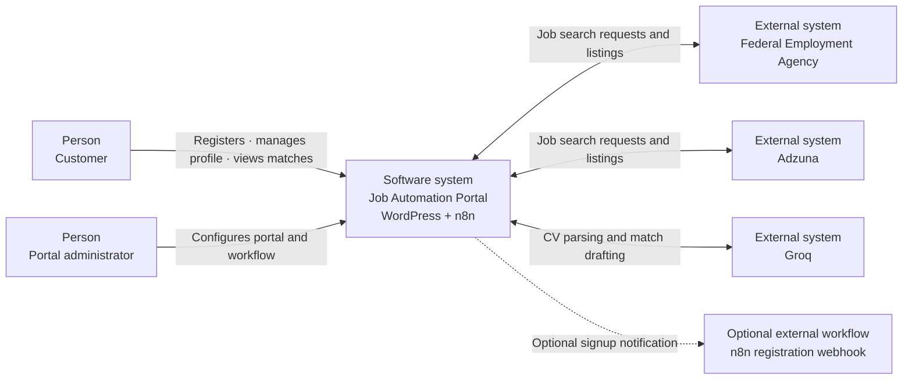
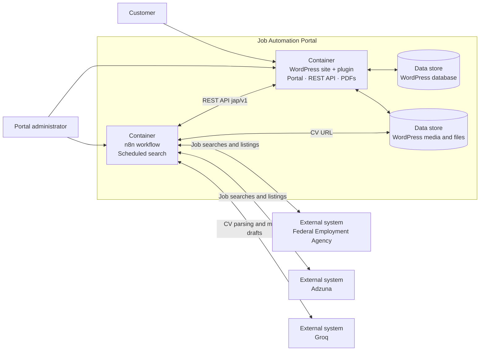
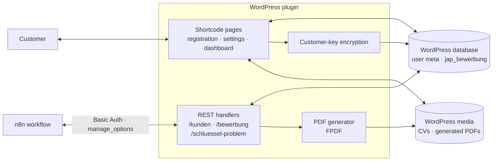
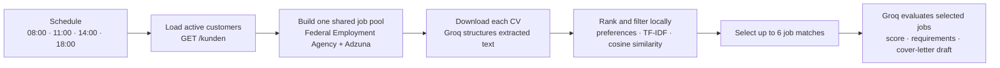
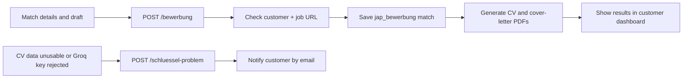

# Software Architecture

Version 5.0.5 · Author: Mohammed Othman

## Purpose and scope

The project has two main runtime components:

- **WordPress plugin**: Customer portal, profile and CV storage, REST API, match records, and PDF generation.
- **Scheduled n8n workflow** (`n8n/apify.json`): Shared job search, per-customer matching, Groq processing, and delivery of results to WordPress.

The scheduled workflow pulls customer data from WordPress through the REST API and posts matches back through that API. It also downloads CV files from their WordPress URLs. An optional registration webhook can notify a separate n8n workflow, but that separate workflow is not included in this repository export.

## Context and scope

The main software system is the Job Automation Portal. Customers use it to manage their CV and search preferences and to review job matches. The WordPress plugin and scheduled n8n workflow are the two main parts of the system. The optional registration webhook is a separate workflow and is not included in this repository export.

### Context diagram (C4 Level 1: System Context)

This is the system boundary view: who uses the portal and which external services it relies on.

### Container diagram (C4 Level 2: Containers)

This view opens the portal system to show the main deployable parts and data stores.

### Plugin component diagram (C4 Level 3: WordPress plugin)

This view focuses on responsibilities inside the WordPress plugin. The n8n workflow is the external caller of the REST endpoints.

The WordPress REST routes require the `manage_options` capability. The n8n integration uses a WordPress administrator application password over Basic Auth.

## Workflow views

### Search and matching

The schedule uses the n8n instance timezone. The `/kunden` endpoint returns at most 200 active customers per request; the workflow does not paginate beyond that limit. CV text is parsed by Groq first. Matching and strict-requirement filtering then run locally in n8n, and only the selected matches receive job-specific Groq processing.

### Results and error handling

The plugin checks for duplicate matches before saving. The key-problem route reports an unusable CV/Groq key and rate-limits customer notifications.

## Components

| Component | Responsibility | Implementation |
|---|---|---|
| Portal forms and shortcodes | Registration, login, customer settings, dashboard, contact and legal pages | `includes/startseite.php`, `einstellungen.php`, `kontakt.php`, `rechtstexte.php`, `seiten.php` |
| WordPress storage | User accounts and profile fields in user meta; job matches as `jap_bewerbung` posts | `job-automation-portal.php` |
| REST API | Customer retrieval, match creation, and key-problem reporting for n8n | `jap/v1/kunden`, `jap/v1/bewerbung`, `jap/v1/schluessel-problem` |
| Key encryption | Encrypts each customer's Groq key using a key derived from WordPress salts | `includes/verschluesselung.php` |
| PDF generation | Creates CV and cover-letter PDFs on the WordPress server | `includes/pdf.php`, `includes/pdf-document.php`, `lib/fpdf` |
| Scheduled workflow | Builds a job pool, ranks matches, calls Groq, and writes results | `n8n/apify.json` |
| External services | Job listings and language-model processing | Federal Employment Agency API, Adzuna, and Groq |

## Data model

### Customer profile

Customer fields are stored as WordPress user meta.

| Field | Meaning |
|---|---|
| `jap_cv_url` | URL of the uploaded CV |
| `jap_standort` / `jap_standort_key` | Selected search location or locations |
| `jap_suchweite` | Search radius in kilometres |
| `jap_arbeitszeit` / `jap_arbeitszeit_labels` | Selected work types |
| `jap_bereiche` / `jap_keywords` / `jap_branche` | Selected fields and derived search terms |
| `jap_status` | `aktiv` or `inaktiv`; controls inclusion in a scheduled run |
| `jap_key_problem*` | Key-problem note and notification timestamp |

### Job match

Each match is stored as a custom post of type `jap_bewerbung`, with post meta for:

- Customer ID, company, location, and work model.
- Groq score and explanation.
- Source job URL and discovery date.
- Generated CV and cover-letter PDF links.
- Detected application email, subject, and cover-letter text.

Before creating a match, the plugin checks the customer ID and job URL to avoid storing the same listing repeatedly.

## Security and privacy boundaries

- The three `jap/v1/*` integration endpoints require the WordPress `manage_options` capability. The n8n `WP Portal Auth` credential uses a WordPress administrator application password over Basic Auth; treat it as an administrator credential and keep it private.
- Each customer's Groq API key is encrypted in user meta using WordPress salts. Protect the salts and backups.
- Adzuna App ID and key are shared site-level credentials stored in WordPress options. They are used to build the shared job pool; they are not individual customer keys.
- Groq calls use each customer's personal key. The workflow sends up to 7,000 characters of extracted CV text for CV parsing and sends relevant profile and job details for match evaluation and drafting.
- The WordPress server stores uploaded CVs and generated PDFs. The n8n workflow downloads CVs by URL while processing them.
- Review the site's privacy notice and service settings before using real customer data. The repository's imprint and privacy texts are templates, not legal advice.

## Operations and known limits

- **Schedule**: 08:00, 11:00, 14:00, and 18:00 in the n8n instance timezone. The exported workflow does not set that timezone.
- **Customer batch**: `/kunden` returns up to 200 active customers per request. The workflow does not paginate beyond that limit.
- **Candidate volume**: Local ranking selects up to six matches per customer for Groq processing.
- **Shared job pool**: Job source queries are made for the batch; results are then ranked for each customer.
- **Deployment URL**: The export contains the current WordPress URL in three HTTP Request nodes. Update all three when deploying to another site.
- **Credentials**: Recreate the `WP Portal Auth` Basic Auth credential after importing the workflow. The export contains a credential reference, not the application password.

## Repository map

| Path | Contents |
|---|---|
| `job-automation-portal.php` | Main plugin, custom post type, shortcodes, REST routes, and webhook setting |
| `includes/` | Forms, settings, legal text, encryption, and PDF generation |
| `lib/fpdf/` | Third-party PDF library and license |
| `assets/` | Portal CSS and images |
| `n8n/apify.json` | Exported scheduled n8n workflow |
| `README.md` | Project overview and setup steps |
