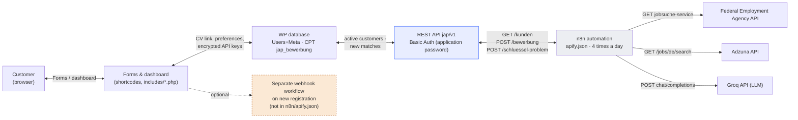
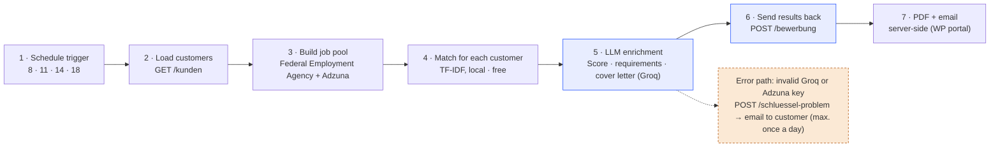

# Software Architecture

Version 5.0.5 · Author: Mohammed Othman

## Overview

The system consists of two independently running parts that communicate exclusively through the plugin's REST API:

- **WordPress plugin** (`job-automation-portal.php` + `includes/`): Customer portal and data storage. Registration, CV upload, preferences, dashboard, and PDF generation.
- **n8n workflow** (`n8n/apify.json`): Standalone automation that fetches work itself (pull) instead of having work sent to it (push).

This separation means the portal keeps working when n8n is unavailable, and the workflow can be tested and changed independently of the plugin code.

## System architecture

n8n fetches the work itself (pull) instead of having the portal push it (push). Registration can also trigger a separate webhook (plugin setting `jap_n8n_webhook_url`), but that webhook is not part of the workflow documented here. The search run retrieves all active customers itself, whether or not the webhook is configured.

| Component | Responsibility | Files / endpoints |
|---|---|---|
| Forms & shortcodes | Registration, login, customer settings, dashboard, contact, legal text | `includes/startseite.php`, `einstellungen.php`, `kontakt.php`, `rechtstexte.php`, `seiten.php` |
| WP database | User accounts and preferences as user meta; one custom post type `jap_bewerbung` per job match | `job-automation-portal.php` (register_post_type, register_post_meta) |
| REST API `jap/v1` | The only interface for n8n: retrieve customers, write matches, report invalid keys | `/kunden` · `/bewerbung` · `/schluessel-problem` |
| Encryption | Customer API keys are never stored in plain text; the key is derived from WordPress salts | `includes/verschluesselung.php` |
| PDF generation | Server-side CVs and cover letters, without a Google account or external service | `includes/pdf.php`, `pdf-document.php`, `lib/fpdf` |
| n8n automation | Scheduled search, evaluation, and document generation | `n8n/apify.json` |
| External services | Job sources and LLM evaluation, each using the customer's personal key | Federal Employment Agency job listings API · Adzuna · Groq |

## Automation pipeline

Cost control happens before AI: step 4 filters and sorts using text statistics only (TF-IDF/Cosine Similarity), then sends just the six best matches per customer to Groq in step 5. This keeps LLM calls low while using each customer's personal Groq key instead of a shared account.

**Why use a shared job pool?** Adzuna limits the number of requests per month. The workflow therefore searches once for all customers together (combining cities and search terms), then distributes the results to each customer instead of searching separately for every customer.

**Why filter out strict requirements?** Jobs with phrases such as “several years of professional experience” or “senior” are excluded before evaluation. This saves Groq calls on matches that are unlikely to suit students.

## Data model

### Customer — user meta

| Field | Meaning |
|---|---|
| `jap_cv_url` | Link to the uploaded CV |
| `jap_standort` / `_key` | City or cities selected for the search |
| `jap_suchweite` | Search radius in km |
| `jap_arbeitszeit` / `_labels` | Working student, internship, part-time, mini-job, full-time, thesis |
| `jap_bereiche` / `jap_keywords` / `jap_branche` | Selected fields of study and the search terms derived from them |
| `jap_status` | `aktiv`/`inaktiv` — determines whether n8n includes the customer in its next run |
| `jap_key_problem*` | Note and timestamp when Groq or Adzuna rejects a customer's key |

### Job match — custom post type `jap_bewerbung`

| Field | Meaning |
|---|---|
| `jap_user_id` | The customer the match belongs to |
| `jap_company` / `jap_location` / `jap_work_model` | Company, location, and work model |
| `jap_score` / `jap_reason` | Groq evaluation (0–100) and explanation |
| `jap_cv_link` / `jap_cover_link` | Generated PDF documents for this match |
| `jap_job_url` / `jap_date_found` | Job listing source and time found |
| `jap_bewerbungs_email` / `jap_betreff` / `jap_brieftext` | Detected application email address and generated cover letter text |

Before saving, a match is checked for duplicates using `jap_user_id` + `jap_job_url`. The workflow searches across a multi-day time window; without this check it could create the same job again on every run.

## Security

- Customer API keys (Groq, Adzuna) are stored encrypted. The encryption key is derived from WordPress salts (`AUTH_KEY` and others), so it is not stored in the database itself.
- The `jap/v1/*` REST endpoints are not public. n8n authenticates with a WordPress application password (Basic Auth) for an account with write access.
- Each customer uses their own Groq and Adzuna keys. n8n does not hold shared LLM credit; if a key is misused, only that customer is affected.
- An invalid key triggers an explicit error message to the customer (at most once per day), instead of silently returning no more matches.
- The privacy policy and imprint texts are templates according to the code comment, not legal advice; review them before launch.

## Operations & repository

| Path | Contents |
|---|---|
| `job-automation-portal.php` | Main plugin file: post type, shortcodes, REST endpoints, webhook setting |
| `includes/` | Forms, settings, legal text, encryption, PDF generation |
| `lib/fpdf/` | PDF library (third-party code; license included) |
| `assets/` | CSS and images for the portal |
| `n8n/apify.json` | Exported n8n workflow — import using “Import from File” |

To run the system, you need a WordPress installation with the plugin, an n8n instance with the workflow imported, an admin application password for REST authentication, a shared Adzuna account, and a separate Groq key for each customer. Recreate the `WP Portal Auth` credential in n8n after importing; the export contains a reference only, not any secrets.
