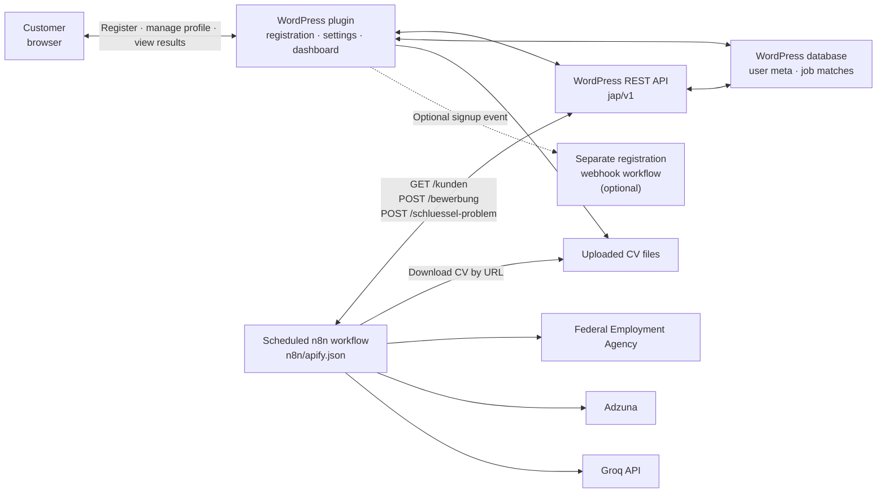

# Job Automation Portal

A WordPress plugin for a customer portal that supports automated job searches. Version 5.0.5.

The project combines a WordPress plugin with an n8n workflow. The scheduled workflow **pulls** active customer profiles from the portal, searches job sources, ranks matches, uses Groq to prepare match details and application drafts, and sends results back to WordPress. An optional registration webhook is separate from the scheduled workflow.

See [ARCHITECTURE.md](ARCHITECTURE.md) for the component design, data flow, data model, security boundaries, and operating limits.

## What the system does

Customers create an account, upload a CV, and save search preferences such as location, work schedule, and field of interest. The n8n workflow builds a shared job pool from the Federal Employment Agency and Adzuna, then ranks jobs for each active customer. Text-based matching runs locally in n8n; Groq is used for CV extraction, match evaluation, requirement summaries, and German cover-letter drafts. The WordPress plugin stores matches, generates PDFs, and shows the results in the customer dashboard.

The system prepares search results and application documents. It does **not** submit job applications automatically.

## Architecture at a glance



## Main features

- **Registration and login**: `[jap_register]` and `[jap_login]`.
- **Customer settings**: `[jap_einstellungen]` for CV, preferences, and a personal Groq API key. Personal keys are encrypted using the WordPress salts.
- **Customer dashboard**: `[jap_dashboard]` displays matching jobs, scores, explanations, and generated application documents.
- **n8n integration**: REST endpoints under `jap/v1/*` let the workflow retrieve active customers and return match results.
- **PDF generation**: CVs and cover letters are generated by the WordPress server with the included FPDF library in `lib/fpdf`.
- **Other portal pages**: contact form, imprint and privacy-policy templates, About Us and Terms and Conditions shortcodes, and an admin page for landing-page text.

## Scheduled workflow

The exported workflow is `n8n/apify.json`. Import it into n8n using **Import from File**.

1. **Schedule**: Runs at 08:00, 11:00, 14:00, and 18:00 in the n8n instance timezone.
2. **Load customers**: Calls `jap/v1/kunden` with the n8n Basic Auth credential `WP Portal Auth`. The endpoint returns at most 200 active customers per request; the workflow does not paginate.
3. **Build a shared job pool**: Searches the Federal Employment Agency and Adzuna, then combines the listings before matching them to individual customers.
4. **Parse each CV**: n8n downloads the customer's CV and sends up to 7,000 characters of extracted text to Groq using the customer's personal key to create structured CV details.
5. **Rank locally**: Uses text statistics, including TF-IDF and cosine similarity, plus location and preference checks. This matching step does not call an AI service. Strict requirements such as required years of experience or senior roles are filtered before job-specific AI evaluation.
6. **Enrich up to six selected matches**: Groq uses the customer's personal key to score each selected match, summarize requirements, and draft a German cover letter.
7. **Return results**: Sends match data to `jap/v1/bewerbung`. WordPress checks for duplicates, stores the match, generates PDFs, and displays it on the dashboard.
8. **Report key problems**: The workflow can report a rejected or unusable customer key through `jap/v1/schluessel-problem`.

## Installation and configuration

1. Install and activate the plugin on a WordPress site.
2. Configure the shared Adzuna credentials in the portal's settings.
3. Create a WordPress administrator application password. In n8n, create a **Basic Auth** credential named `WP Portal Auth` using the WordPress username and application password.
4. Import `n8n/apify.json` into n8n and select the `WP Portal Auth` credential. The export contains a credential reference, not the secret itself.
5. If the site URL changes, update the WordPress URL in the workflow's three WordPress HTTP Request nodes.
6. Add a personal Groq API key for each customer in their portal settings.
7. Set the correct n8n instance timezone, review the schedule, then activate the workflow.

Keep the administrator application password private. The REST endpoints require the WordPress `manage_options` capability.

## Data and privacy notes

The workflow downloads each customer's CV from its WordPress URL. It sends up to 7,000 characters of extracted CV text, along with relevant profile and job details, to Groq for processing. Review the site's privacy notice and service configuration before using real customer data; the repository's legal texts are templates and should be reviewed before launch.

Adzuna credentials are shared site-level settings. Groq keys are personal customer credentials and are stored encrypted using WordPress salts.

## Project structure

```text
job-automation-portal.php   Main plugin: post type, shortcodes, REST API, webhook setting
includes/                   Portal forms, settings, encryption, legal text, and PDF generation
lib/fpdf/                   Included PDF library and license
assets/                     CSS and image assets
n8n/apify.json              Exported scheduled n8n workflow
ARCHITECTURE.md             Detailed architecture, data model, security, and operations
```

## Author

Mohammed Othman
